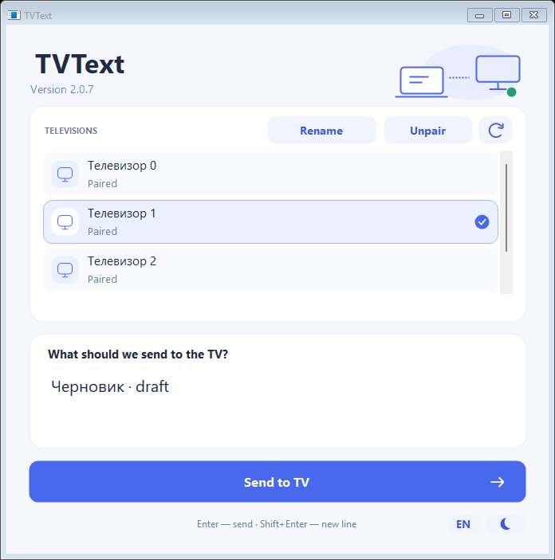
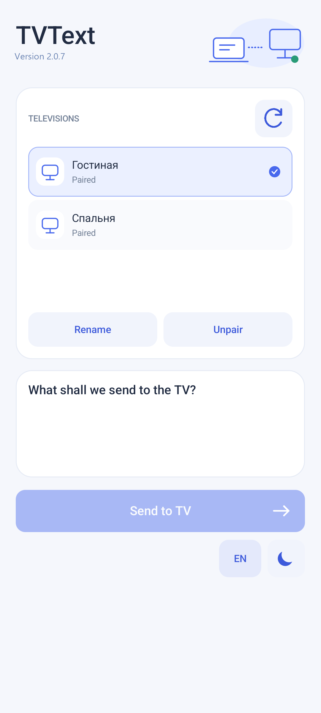
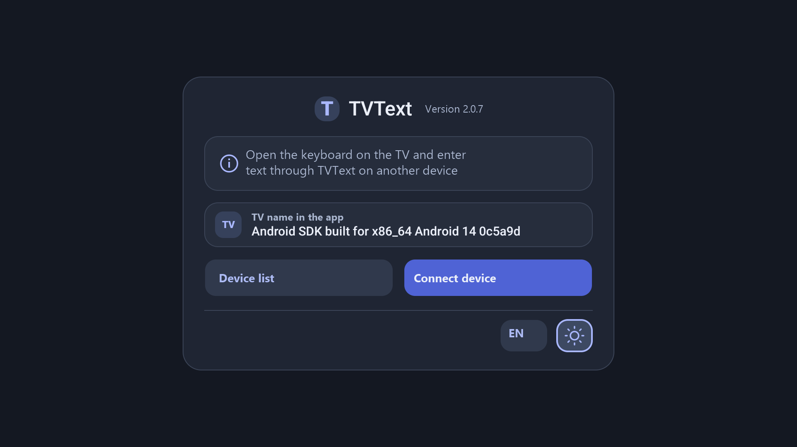

# TVText

[Русская версия](README.ru.md)

TVText sends text from a Windows PC or an Android phone/tablet to the active text field on a Google TV. Everything stays on the local network: discovery uses mDNS/DNS-SD and text uses a pinned TLS connection. No cloud service or message history is used.

## Components

| Component | Source folder | Package or runtime | Purpose |
| --- | --- | --- | --- |
| TV receiver | `android-tv/` | `com.tvtext.app`, Android 9+ / target 34 | Receives text through the TV accessibility service and inserts it into the active field. |
| Mobile sender | `android-mobile/` | `com.tvtext.mobile.app`, Android 9+ / target 34 | Finds TVs, pairs with a code, and sends text from a phone or tablet. |
| Windows sender | `windows/` | .NET Framework 4.8, Windows Forms | Finds TVs, pairs with a code, and sends text from Windows. |

The TV and mobile APKs use Kotlin and framework Views; the Windows application uses C#. The Android packages have different application IDs and can be installed together.

## Screenshots

<p align="center">
  
</p>

<p align="center">
  
</p>

<p align="center">
  
</p>

## Requirements

- Windows 10/11 with .NET Framework 4.8 for the EXE.
- Android Studio with its JDK and Kotlin compiler.
- The Android/JVM tool versions pinned in `toolchain.json` for Android builds and tests.
- A TV, PC, phone, or tablet on the same Wi-Fi network. Guest Wi-Fi, VPNs, and client isolation can block discovery.

The project uses the Android command-line tools directly. Gradle and network downloads are not required by the build script.

## Build

Run PowerShell from this directory:

```powershell
.\build.ps1 -Sdk 'C:\Users\YOUR_USER\AppData\Local\Android\Sdk'
```

Optional parameters are `-Jdk`, `-Kotlin`, `-Output`, and `-Target All|TV|Mobile|Windows`. The default output directory is `dist/`.

`-Target Windows` requires no Android SDK, JDK, Kotlin or APK signing key. Application versions come from `version.json`; Android tool versions are checked against `toolchain.json`. See the [build guide](docs/building/BUILD.md) for setup and matching APK/device-test records.

The build creates:

- `TVText-TV-2.0.10.apk` for the TV;
- `TVText-Mobile-2.0.10.apk` for phones and tablets;
- `TVText-2.0.10.exe` and `TVText-2.0.10.exe.config` for Windows.

The first build creates an APK signing key in `.local/`. Keep `signing.p12` and its password outside source control and back them up privately. A fresh clone without that key creates a different signing identity, so an already installed APK must be removed before installing that independent build.

## Tests

```powershell
.\test.ps1 -Sdk 'C:\Users\YOUR_USER\AppData\Local\Android\Sdk'
.\test.ps1 -Shrink -Sdk 'C:\Users\YOUR_USER\AppData\Local\Android\Sdk'
.\test-mobile.ps1 -Sdk 'C:\Users\YOUR_USER\AppData\Local\Android\Sdk'
```

For the real Android UI/instrumentation suite, pass an explicitly named isolated emulator and a release APK:

```powershell
.\test-mobile.ps1 -Device emulator-5580 `
  -Sdk 'C:\Users\YOUR_USER\AppData\Local\Android\Sdk' `
  -AppApk '.\dist\TVText-Mobile-2.0.10.apk'
```

Test sources are grouped by target: `tests/android-tv/` contains TV engine and accessibility-fixture checks, `tests/android-mobile/` contains phone/tablet checks, and `tests/windows/` contains Windows client and layout checks. The scripts use local TLS fixtures on `127.0.0.1`; they do not use saved TV credentials or an external network.

The suite covers framing and UTF-8 limits, pairing expiry and lockout, certificate pinning, token revocation, idempotency, cancellation and deadlines, IPv4/IPv6 handling, mDNS resource cleanup, DPAPI and encrypted profile storage, Windows DPI/layout and keyboard routing, mobile NSD/Keystore storage, rotation, draft preservation, and multi-TV isolation. Device tests run only on an explicitly named emulator.

## Runtime and security

- mDNS is used as a discovery hint. The Windows client does not poll the TV while idle; it connects for pairing, recovery, or an explicit send. Android discovery runs on the first launch when no pairing is saved, on manual refresh, and when a send needs endpoint recovery; there is no background service.
- Pairing uses an eight-digit code valid for five minutes with ten failed attempts allowed. Each paired client receives an independent random token.
- The client first probes the TV certificate without sending application data. The user compares the displayed fingerprint, then the client pins the full SHA-256 certificate for later exchanges. TLS 1.2 is used.
- Windows profiles are protected with DPAPI. Mobile profiles use an Android Keystore AES-GCM key and an atomic file in `noBackupFilesDir`.
- A successful acknowledged send clears the submitted draft. A failed or ambiguous send preserves it; TVText never retries text automatically.

## Protocol limits

Each frame has a four-byte big-endian length and is limited to 65536 bytes. Strings carry their UTF-8 byte length. Text is limited to 32768 UTF-8 bytes. Requests use protocol version 1 and commands for pairing, status, and insertion. Responses include the result, readiness, message, token, target package, and stable TV identifier.

The TV listens on TCP 45831 over IPv4. The receiver advertises and accepts IPv4 only. The advertised installation ID lets a client recover a changed address without pairing again, provided the pinned certificate still matches.

## Source layout

```text
android-tv/            TV receiver
android-mobile/        phone/tablet sender
windows/               Windows sender
docs/images/           README screenshots
docs/changes/          platform change logs
docs/guides/           user guides
docs/testing/          test documentation
tests/android-tv/      TV engine and accessibility fixture tests
tests/android-mobile/  phone/tablet tests
tests/windows/         Windows client and layout tests
tests/tooling/         build and artifact consistency checks
scripts/               shared build/test helpers
version.json           application version and Android version code
toolchain.json         pinned Android/JVM tools
build.ps1              build all or one target
test.ps1               Windows/TV tests
test-mobile.ps1        mobile JVM and device tests
test-tv-ui.ps1         TV device tests
```

Project and user documentation: [Russian README](README.ru.md), [user guide](docs/guides/USER_GUIDE.md), [Russian user guide](docs/guides/USER_GUIDE.ru.md), [test report](docs/testing/TESTS.md), and [Russian test report](docs/testing/TESTS.ru.md). Platform change logs are in `docs/changes/`.

## GitHub and releases

Use this directory as the repository root. `.gitignore` excludes build output, emulator state, generated test results, signing material, and release binaries. Keep APK and EXE files in a GitHub Release rather than source commits. The Windows 2.0.10 release must keep `TVText-2.0.10.exe.config` beside the EXE. The source is released under the MIT License in `LICENSE`.

## Known limits

Physical TV firmware, Gboard, and third-party input fields can filter, transform, or reject inserted text and still need validation on the target TV. The automated Android tests use isolated Android 9, Android 12 and Android 14 emulators and controlled input fields; they do not replace that check. Android 10–12 clipboard restrictions can prevent restoration after background Paste, leaving the sent text in the clipboard; this is reproduced on Android 12 and recorded in the compatibility report. If no active editable field exists, the request is rejected and not replayed later.

## References

- [Android accessibility input connection](https://developer.android.com/reference/android/view/inputmethod/InputConnection)
- [Android NSD](https://developer.android.com/reference/android/net/nsd/NsdManager)
- [Windows DNS-SD](https://learn.microsoft.com/en-us/windows/win32/api/windns/nf-windns-dnsservicebrowse)
