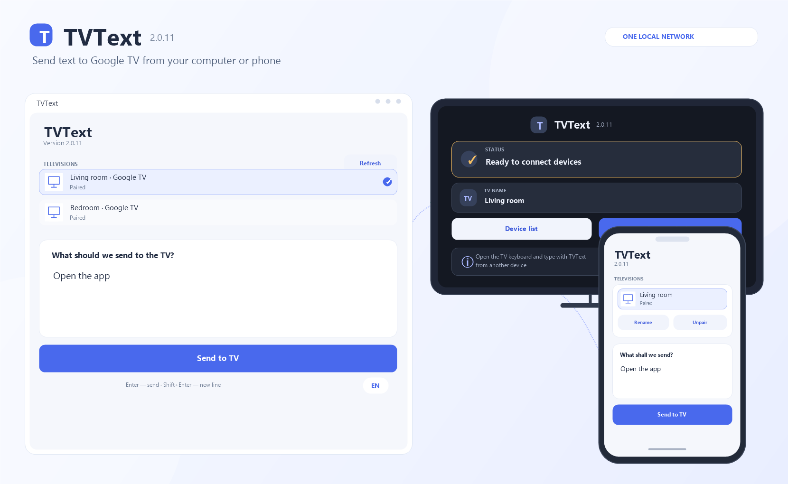

# TVText

[Русская версия](README.ru.md)

TVText sends text from a Windows computer or an Android phone/tablet to the active text field on Google TV. Devices discover each other over the local network with mDNS/DNS-SD; text is sent through a TLS connection with certificate pinning. TVText has no cloud service and keeps no message history.

## Apps

| App | Folder | Platform |
| --- | --- | --- |
| TV receiver | `android-tv/` | Google TV, Android 9+ |
| Mobile sender | `android-mobile/` | Android phones and tablets, Android 9+ |
| Windows sender | `windows/` | Windows 10/11, .NET Framework 4.8 |

The Android apps use Kotlin and framework Views; the Windows app uses C# and Windows Forms. The two APKs have separate package IDs and can be installed together.

## Overview

<p align="center">
  
</p>

## Build

Build all three apps from PowerShell at the repository root:

```powershell
.\build.ps1 -Sdk 'C:\Users\YOUR_USER\AppData\Local\Android\Sdk'
```

The output contains `TVText-TV-<version>.apk`, `TVText-Mobile-<version>.apk`, `TVText-<version>.exe`, and its `.exe.config` file. Use `-Target TV|Mobile|Windows` to build one app; Windows builds do not need the Android SDK or APK signing key. The Android toolchain versions are pinned in `toolchain.json`; Gradle and network downloads are not required.

The first Android build creates a signing key in `.local/`. Keep the key and its password private and back them up. A build signed with a different key cannot update an existing installation. See the [build guide](docs/building/BUILD.md) for tool setup and options.

## Tests

Run the core suites with the project toolchain:

```powershell
.\tests\test.ps1 -Sdk 'C:\Users\YOUR_USER\AppData\Local\Android\Sdk'
.\tests\test-mobile.ps1 -Sdk 'C:\Users\YOUR_USER\AppData\Local\Android\Sdk'
```

Android UI tests are opt-in and require an explicitly selected emulator. The tests cover protocol compatibility, pairing and certificate checks, storage, discovery, text entry, and Windows/mobile UI behavior. See the [test guide](tests/README.md) for commands and coverage.

## Security and limitations

Pairing uses a temporary eight-digit code. The user checks the TV certificate fingerprint before it is pinned for later connections. Windows credentials are protected with DPAPI; Android credentials use Android Keystore. TVText does not automatically resend text when delivery is uncertain.

All devices must be on a network that allows local discovery and connections. The TV receiver listens on TCP port 45831 over IPv4. Android 10–12 may prevent TVText from clearing the clipboard after background text insertion, and TV firmware, keyboards, or individual apps may alter or reject inserted text. Test compatibility on the target TV.

## Project and license

Source code is in `android-tv/`, `android-mobile/`, and `windows/`; tests and documentation are under `tests/` and `docs/`. Read the [user guide](docs/guides/USER_GUIDE.md), [test report](docs/testing/TESTS.md), and platform change logs in `docs/changes/`.

TVText is released under the [MIT License](LICENSE).
