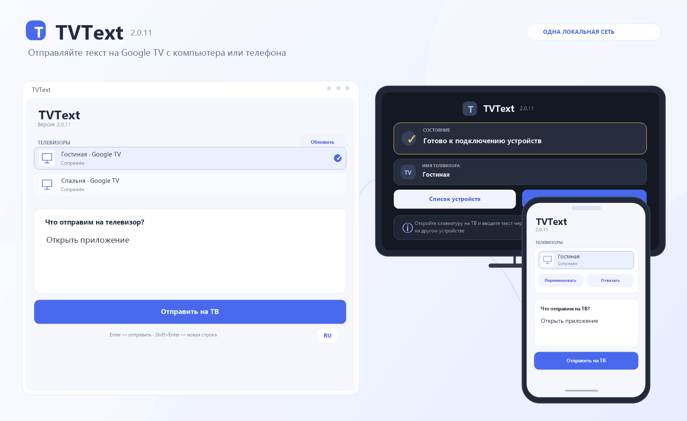

# TVText

[English version](README.md)

TVText передаёт текст с компьютера Windows или телефона/планшета Android в активное поле ввода на Google TV. Устройства находятся в локальной сети через mDNS/DNS-SD, а текст передаётся по TLS с проверкой и закреплением сертификата. Облачного сервиса и истории сообщений нет.

## Быстрый старт

1. Установите `TVText-TV` на телевизор и `TVText-Mobile` на телефон/планшет или `TVText` на Windows. Для Windows оставьте `.exe.config` рядом с EXE. Подключите устройства к одной Wi-Fi сети.
2. Откройте TVText на телевизоре и, если потребуется, включите приложение в специальных возможностях. Нажмите **«Подключить устройство»** и оставьте на экране код.
3. Запустите приложение-отправитель, выберите телевизор и нажмите **«Подключить»**. Введите код с ТВ и сверьте отпечаток сертификата.
4. На ТВ откройте нужное приложение, поле ввода и экранную клавиатуру. Введите текст в TVText и нажмите **«Отправить на ТВ»** или Enter.

## Приложения

| Приложение | Папка | Платформа |
| --- | --- | --- |
| Приёмник для ТВ | `android-tv/` | Google TV, Android 9 и новее |
| Отправитель для телефона и планшета | `android-mobile/` | Android 9 и новее |
| Отправитель для Windows | `windows/` | Windows 10/11, .NET Framework 4.8 |

Приложения для Android написаны на Kotlin и используют системные Views; Windows-приложение написано на C# и Windows Forms. APK для ТВ и телефона имеют разные идентификаторы пакета и устанавливаются одновременно.

## Обзор

<p align="center">
  
</p>

## Сборка

Соберите все три приложения из PowerShell в корне репозитория:

```powershell
.\build.ps1 -Sdk 'C:\Users\YOUR_USER\AppData\Local\Android\Sdk'
```

В папке результата будут `TVText-TV-<версия>.apk`, `TVText-Mobile-<версия>.apk`, `TVText-<версия>.exe` и файл конфигурации `.exe.config`. Параметр `-Target TV|Mobile|Windows` выбирает отдельное приложение. Для сборки Windows не нужны Android SDK и ключ подписи APK. Версии Android-инструментов закреплены в `toolchain.json`; Gradle и загрузка зависимостей из сети не требуются.

При первой Android-сборке в `.local/` создаётся ключ подписи. Храните его и пароль отдельно от Git и сделайте резервную копию: APK с другим ключом не установится поверх существующей копии приложения. Настройка инструментов и параметры описаны в [руководстве по сборке](docs/building/BUILD.ru.md).

## Тесты

Запуск основных наборов тестов с инструментами проекта:

```powershell
.\tests\test.ps1 -Sdk 'C:\Users\YOUR_USER\AppData\Local\Android\Sdk'
.\tests\test-mobile.ps1 -Sdk 'C:\Users\YOUR_USER\AppData\Local\Android\Sdk'
```

Android UI-тесты запускаются отдельно и требуют явно указанного эмулятора. Проверяются совместимость протокола, сопряжение и сертификаты, хранение данных, обнаружение устройств, ввод текста и поведение интерфейсов Windows и Android. Команды и покрытие перечислены в [описании тестов](tests/README.ru.md).

## Безопасность и ограничения

Для сопряжения используется временный восьмизначный код. Перед первым соединением пользователь сверяет отпечаток сертификата ТВ; после этого сертификат закрепляется для следующих подключений. Данные Windows защищены DPAPI, данные Android — Android Keystore. При неясном результате отправки TVText не повторяет её автоматически.

Устройства должны находиться в сети, которая разрешает локальное обнаружение и подключения. ТВ принимает соединения по IPv4 через TCP-порт 45831. На Android 10–12 система может не дать TVText очистить буфер обмена после фоновой вставки текста. Прошивка ТВ, клавиатура и отдельные приложения также могут изменить или отклонить вставленный текст — совместимость стоит проверить на своём телевизоре.

## Проект и лицензия

Исходники приложений находятся в `android-tv/`, `android-mobile/` и `windows/`; тесты и документация — в `tests/` и `docs/`. См. [руководство пользователя](docs/guides/USER_GUIDE.ru.md), [отчёт о тестах](docs/testing/TESTS.ru.md) и журналы изменений платформ в `docs/changes/`.

TVText распространяется по [лицензии MIT](LICENSE).
