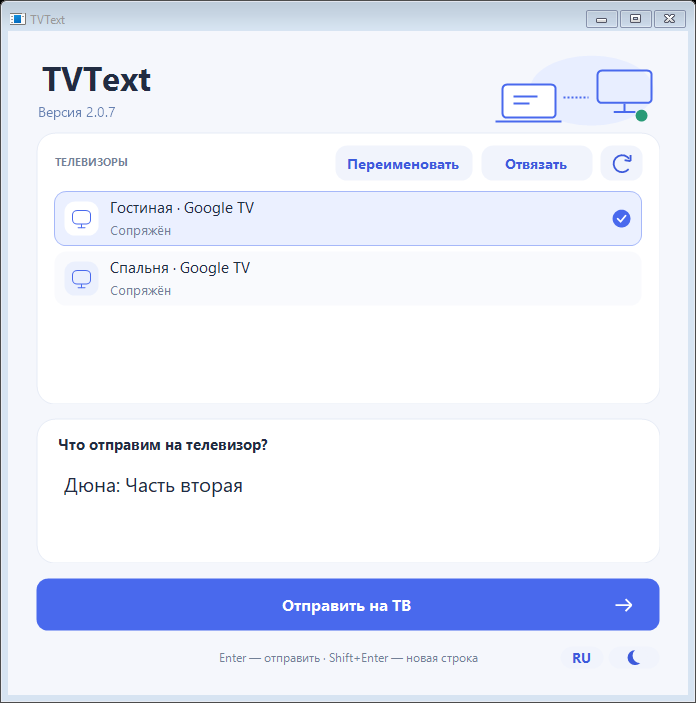
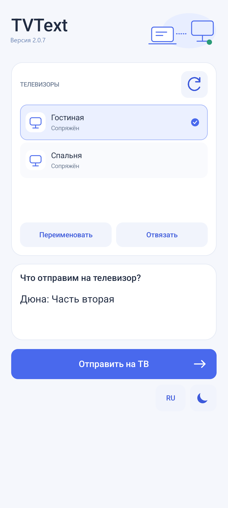
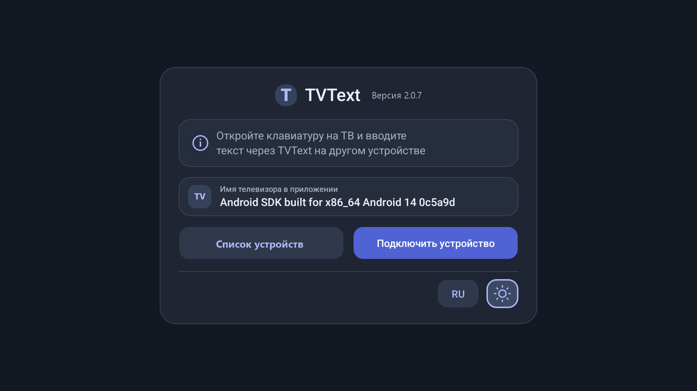

# TVText

[English version](README.md)

TVText передаёт текст с Windows-ПК или телефона/планшета Android в активное поле ввода на Google TV. Всё работает в локальной сети: устройства находятся через mDNS/DNS-SD, а текст передаётся по TLS с проверкой сертификата. Облачного сервера и истории сообщений нет.

## Компоненты

| Компонент | Исходники | Пакет или среда | Назначение |
| --- | --- | --- | --- |
| Приёмник на ТВ | `android-tv/` | `com.tvtext.app`, Android 9+ / target 34 | Получает текст через службу специальных возможностей и вставляет его в активное поле. |
| Отправитель для телефона | `android/` | `com.tvtext.mobile.app`, Android 9+ / target 34 | Находит телевизоры, подключается по коду и отправляет текст с телефона или планшета. |
| Отправитель для Windows | `windows/` | .NET Framework 4.8, Windows Forms | Находит телевизоры, подключается по коду и отправляет текст с Windows. |

Приложения для ТВ и мобильных устройств написаны на Kotlin и используют системные Views. Windows-приложение написано на C#. У Android-приложений разные идентификаторы, поэтому их можно устанавливать одновременно.

## Скриншоты

<p align="center">
  
</p>

<p align="center">
  
</p>

<p align="center">
  
</p>

## Требования

- Windows 10/11 и .NET Framework 4.8 для EXE.
- Android Studio с JDK и компилятором Kotlin.
- Android SDK API 34 или новее и Android build-tools.
- ТВ, ПК, телефон или планшет в одной Wi-Fi сети. Гостевая сеть, VPN и изоляция клиентов могут блокировать поиск.

Проект использует командные инструменты Android напрямую. Gradle и загрузка зависимостей из сети для сборки не нужны.

## Сборка

Запустите PowerShell из этой папки:

```powershell
.\build.ps1 -Sdk 'C:\Users\YOUR_USER\AppData\Local\Android\Sdk'
```

Дополнительные параметры: `-Jdk`, `-Kotlin`, `-Output` и `-Target All|TV|Mobile|Windows`. По умолчанию результат помещается в `dist/`.

Сборка создаёт:

- `TVText-TV-2.0.7.apk` для телевизора;
- `TVText-Mobile-2.0.7.apk` для телефона и планшета;
- `TVText-2.0.7.exe` и `TVText-2.0.7.exe.config` для Windows.

При первой сборке в `.local/` создаются ключ подписи APK и его пароль. Храните `signing.p12` и пароль вне Git и сделайте их отдельную резервную копию. Свежая копия проекта без этого ключа создаст другую подпись, поэтому уже установленный APK придётся удалить перед установкой такой независимой сборки.

## Тесты

```powershell
.\test.ps1 -Sdk 'C:\Users\YOUR_USER\AppData\Local\Android\Sdk'
.\test.ps1 -Shrink -Sdk 'C:\Users\YOUR_USER\AppData\Local\Android\Sdk'
.\test-mobile.ps1 -Sdk 'C:\Users\YOUR_USER\AppData\Local\Android\Sdk'
```

Для полноценного Android UI/instrumentation-прогона укажите отдельный эмулятор и APK релизной сборки:

```powershell
.\test-mobile.ps1 -Device emulator-5580 `
  -Sdk 'C:\Users\YOUR_USER\AppData\Local\Android\Sdk' `
  -AppApk '.\dist\TVText-Mobile-2.0.7.apk'
```

Исходники тестов разделены по продуктам: `tests/android-tv/` содержит проверки движка ТВ и accessibility-фикстуры, `tests/android/` — проверки телефона и планшета, `tests/windows/` — Windows-клиент и компоновку. Скрипты используют локальные TLS-фикстуры на `127.0.0.1`; сохранённые данные ТВ и внешняя сеть не нужны.

Проверяются кадрирование и ограничения UTF-8, срок действия и блокировка сопряжения, pinning сертификата, отзыв ключей, идемпотентность, отмена и тайм-ауты, IPv4/IPv6, освобождение ресурсов mDNS, DPAPI и шифрованное хранение профилей, DPI и клавиатурная маршрутизация Windows, NSD/Keystore мобильного приложения, поворот экрана, сохранение черновика и изоляция нескольких ТВ. Тесты устройства запускаются только на явно указанном эмуляторе.

## Работа и безопасность

- mDNS используется как подсказка для поиска. Windows-клиент не опрашивает ТВ в простое: соединение открывается для сопряжения, восстановления адреса или явной отправки. Android выполняет поиск при первом запуске, если нет сохранённых сопряжений, при ручном обновлении и когда для отправки нужно восстановить адрес; фоновой службы нет.
- Сопряжение использует восьмизначный код, действующий пять минут; допускается десять неверных попыток. Каждый подключённый клиент получает отдельный случайный ключ.
- Сначала клиент проверяет сертификат ТВ без передачи прикладных данных. Пользователь сравнивает отпечаток, после чего клиент фиксирует полный SHA-256 отпечаток для следующих соединений. Используется TLS 1.2.
- Профили Windows защищены DPAPI. Мобильные профили используют ключ Android Keystore AES-GCM и атомарный файл в `noBackupFilesDir`.
- После подтверждённой отправки отправленный черновик очищается. При ошибке или неясном результате он сохраняется; TVText не повторяет отправку автоматически.

## Ограничения протокола

Каждый кадр содержит четырёхбайтовую длину в big-endian и не превышает 65536 байт. Строки передаются с длиной UTF-8. Размер текста ограничен 32768 байтами UTF-8. Запросы используют протокол версии 1 и команды сопряжения, проверки состояния и вставки. Ответ содержит результат, готовность, сообщение, ключ, целевой пакет и постоянный идентификатор ТВ.

ТВ слушает TCP-порт 45831 только по IPv4. Приёмник объявляет и принимает только IPv4. Идентификатор установки позволяет найти ТВ после смены адреса без нового сопряжения, если сохранённый сертификат совпадает.

## Структура исходников

```text
android-tv/       приёмник для ТВ
android/          отправитель для телефона и планшета
windows/          отправитель для Windows
docs/images/      скриншоты для README
docs/changes/     журналы изменений по платформам
docs/guides/      руководства пользователя
docs/testing/     документация тестов
tests/android-tv/ тесты движка ТВ и accessibility-фикстуры
tests/android/    тесты телефона и планшета
tests/windows/    тесты Windows-клиента и компоновки
build.ps1         сборка всех или одного компонентов
test.ps1          тесты Windows/ТВ
test-mobile.ps1   мобильные JVM- и device-тесты
```

Документация проекта и пользователя: [README](README.md), [руководство](docs/guides/USER_GUIDE.ru.md), [английское руководство](docs/guides/USER_GUIDE.md), [отчёт о тестах](docs/testing/TESTS.ru.md) и [английский отчёт о тестах](docs/testing/TESTS.md). Журналы изменений по платформам находятся в `docs/changes/`.

## GitHub и релизы

Корнем репозитория должна быть эта папка. `.gitignore` исключает сборки, состояние эмулятора, результаты тестов, ключ подписи и готовые бинарники. APK и EXE лучше размещать в GitHub Release, а не в истории исходников. Для Windows-релиза 2.0.7 файл `TVText-2.0.7.exe.config` должен лежать рядом с EXE. Исходный код распространяется по лицензии MIT из файла `LICENSE`.

## Известные ограничения

Прошивка конкретного ТВ, Gboard и сторонние поля ввода могут фильтровать, изменять или отклонять вставленный текст; это нужно проверить на целевом телевизоре. Автоматические Android-тесты используют отдельный эмулятор Android 14 и контролируемое поле, поэтому не заменяют такую проверку. Если активного поля нет, запрос отклоняется и позднее не воспроизводится.

## Ссылки

- [Android InputConnection](https://developer.android.com/reference/android/view/inputmethod/InputConnection)
- [Android NSD](https://developer.android.com/reference/android/net/nsd/NsdManager)
- [Windows DNS-SD](https://learn.microsoft.com/en-us/windows/win32/api/windns/nf-windns-dnsservicebrowse)
